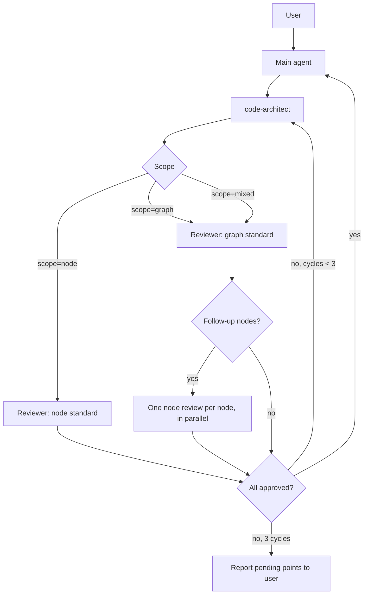

# LangGraph standards governance in Claude Code

## Purpose

A modular system of standards and review for LangGraph components (nodes, graphs and subgraphs). Detailed rules are loaded only by the agents that need them, so they do not consume the main agent's context.

## Components

| Type | File | Purpose | Invocation |
|---|---|---|---|
| Convention | `.claude/conventions/langgraph/state-contracts.md` | Input / Output / State contracts | Read by skills and reviewer |
| Convention | `.claude/conventions/langgraph/naming.md` | `<role>_<instance>` naming and standard roles | Read by skills and reviewer |
| Skill | `.claude/skills/langgraph-design-doc/SKILL.md` | How to write design.md | User and any agent |
| Skill | `.claude/skills/langgraph-node-standards/SKILL.md` | Node standards | Manual: `/langgraph-node-standards` |
| Skill | `.claude/skills/langgraph-graph-standards/SKILL.md` | Graph and subgraph standards | Manual: `/langgraph-graph-standards` |
| Subagent | `.claude/agents/langgraph-standards-reviewer.md` | Read-only, scope-aware reviewer | code-architect or any agent |
| Subagent | code-architect | Designs and delegates review | Existing |

A convention is a reusable text with the same role as a skill, but it is never executed on its own: skills and the reviewer point to it.

## Review flow

## Key rules of the flow

- The reviewer reads only the standard that matches the declared scope, plus the conventions that standard references.
- Mixed proposals: the reviewer reviews only the graph and asks for one node review per node, in parallel.
- Maximum three review cycles per component.
- New roles are proposed as `NEW ROLE (pending approval)` and approved by the user.

## How to extend the system

- New role: the user approves it and it is added to `naming.md`.
- New rule shared by nodes and graphs: add it to a convention (or create a new one in `.claude/conventions/langgraph/`) and reference it from the "Required reading" section of both skills.
- New rule specific to nodes or graphs: add it to the corresponding skill and its compliance checklist.
- Pending topics: listed in section "PENDING" of the graph standards.
